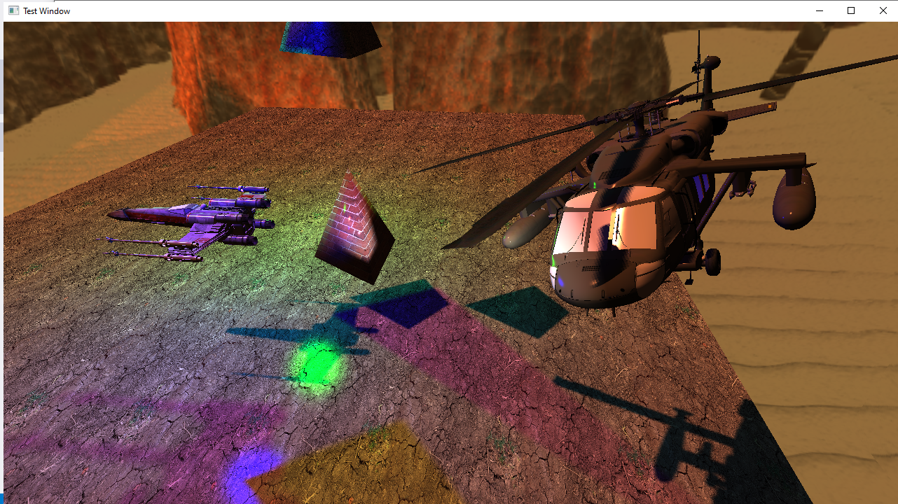

# OpenGLScene

An independently developed 3D graphics project demonstrating real-time rendering, lighting and model loading using OpenGL.

## Overview

OpenGLScene is a C++ application showcasing various OpenGL rendering techniques within an interactive 3D environment.

The scene features:
- 3D model loading and rendering.
- Multiple light sources.
- Skybox rendering.
- Real-time camera movement through the environment.

## Technologies & Libraries

- **C++**
- **OpenGL**
- **GLEW** – OpenGL extension loading.
- **GLFW** – Window management and input handling.
- **Assimp** – 3D model importing.
- **GLM** – Mathematics library for graphics programming.

## Building & Running

1. Open the Visual Studio solution (`.sln`).
2. Build the project using Visual Studio 2015.
3. Run the application.

## Controls

| Key | Action |
|---|---|
| W | Move forward |
| S | Move backward |
| A | Move left |
| D | Move right |
| ESC | Close application |

## Screenshots

See the screenshot below for an example of the rendered scene.

Controls: W = Forward, S = Backward, A = Left, D = Right, ESC = Close
